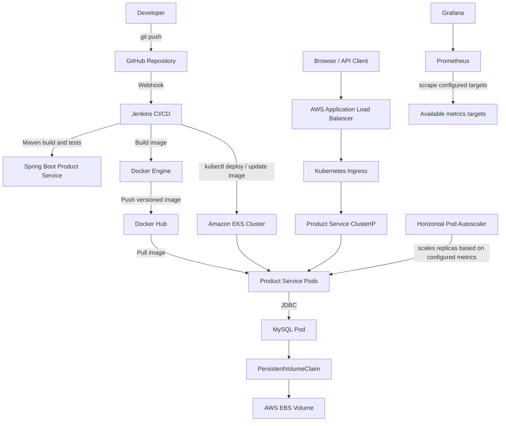

# Cloud-Native Microservices CI/CD Pipeline on AWS EKS

A hands-on DevOps project that automates build, containerization, image publishing, and Kubernetes deployment of a Spring Boot Product Service on Amazon EKS. The application uses MySQL for persistence and is exposed externally through an AWS Application Load Balancer.

> **Project status:** Core deployment, CI/CD, CRUD flow, ingress, autoscaling configuration, and monitoring stack have been implemented. Confirm the exact resource names, environment variables, and screenshots against the live AWS account before publishing this README.

## Project highlights

- CI/CD pipeline with Jenkins and GitHub webhook trigger
- Maven build and test/package stage for a Spring Boot service
- Docker image build and publish to Docker Hub
- Deployment to Amazon EKS using `kubectl`
- Kubernetes rollout status verification and rollback attempt if rollout fails
- MySQL deployment with persistent storage through PVC / EBS-backed storage
- AWS Load Balancer Controller / ALB Ingress for external access
- Horizontal Pod Autoscaler (HPA) configured for Product Service
- Prometheus and Grafana monitoring stack
- Kubernetes Secrets for application/database configuration

## Architecture



## Technology stack

| Area | Technology |
|---|---|
| Application | Java / Spring Boot |
| Build | Maven |
| Containerization | Docker |
| Source control | Git / GitHub |
| CI/CD | Jenkins + GitHub webhook |
| Container registry | Docker Hub |
| Kubernetes | Amazon EKS |
| Networking | AWS Load Balancer Controller, ALB Ingress, Kubernetes Service |
| Database | MySQL |
| Persistent storage | PVC and EBS-backed storage |
| Autoscaling | Kubernetes HPA |
| Monitoring | Prometheus and Grafana |

## CI/CD workflow

1. Developer pushes a change to the GitHub repository.
2. GitHub webhook triggers the Jenkins job.
3. Jenkins checks out the repository.
4. Maven builds the Product Service and runs the configured tests.
5. Jenkins builds a Docker image tagged with the Jenkins build number and `latest`.
6. Jenkins authenticates to Docker Hub using a Jenkins credential and pushes the image tags.
7. Jenkins updates the Kubernetes Deployment image in EKS.
8. Jenkins waits for the Deployment rollout to complete.
9. If rollout verification fails, the pipeline attempts `kubectl rollout undo` and checks the rollback rollout. The pipeline still reports failure for the failed release so the failure remains visible.

## Repository structure

```text
.
├── Jenkinsfile
├── Product-service/
│   ├── Dockerfile
│   ├── pom.xml
│   └── ...
├── docker-compose.yaml
├── k8s/
│   ├── product-deployment.yaml
│   ├── product-service.yaml
│   ├── product-hpa.yaml
│   ├── product-ingress.yaml
│   ├── mysql-deployment.yaml
│   ├── mysql-service.yaml
│   ├── mysql-pvc.yaml
│   ├── mysql-secret.yaml
│   ├── product-secret.yaml
│   ├── gp3-storageclass.yaml
│   └── ...
└── README.md
```

This is a representative structure based on the project files described during implementation. Run `find . -maxdepth 2 -type f` to verify it against the current checkout before publishing.

## Prerequisites

- AWS CLI configured for the intended AWS account and region
- `kubectl` and `eksctl`
- Access to an Amazon EKS cluster
- Docker and Docker Hub account
- Jenkins with Git, JDK, Maven (or Maven Wrapper), Docker access, and Kubernetes credentials configured
- AWS Load Balancer Controller configured if using ALB Ingress
- Prometheus and Grafana installed if enabling monitoring

## Useful validation commands

```bash
# Cluster and nodes
kubectl get nodes -o wide

# Application deployment, pods, service and ingress
kubectl get deploy,pods,svc,ingress
kubectl rollout status deployment/product-service
kubectl describe deployment product-service
kubectl get hpa

# MySQL storage
kubectl get pvc,pv
kubectl describe pvc mysql-pvc

# Application logs
kubectl logs deployment/product-service --tail=100
kubectl logs deployment/mysql --tail=100

# Monitoring resources (if installed in monitoring namespace)
kubectl get pods -n monitoring
kubectl get svc -n monitoring
```

> If the MySQL Deployment has a different name, use the name returned by `kubectl get deployments`. Do not paste secret values into logs, screenshots, GitHub issues, or this README.

## Security notes

- Keep `.env`, tokens, passwords, Kubernetes secret values, kubeconfig files, and AWS credentials out of Git.
- Use Jenkins Credentials for Docker Hub credentials; do not hard-code passwords in the Jenkinsfile.
- For production, use AWS Secrets Manager or another approved secret-management approach, least-privilege IAM, private networking where appropriate, image scanning, and TLS/HTTPS.
- Verify MySQL root/user password configuration before sharing the project publicly.
- Add Trivy or another image/dependency scanner before claiming security scanning is implemented. It is **not listed as completed** in this README.

## Known limitations / future improvements

- Add meaningful automated unit/integration tests; a successful Maven build can still report “No tests to run”.
- Integrate Trivy image scanning and define a policy for blocking critical vulnerabilities.
- Configure alert rules and verify notifications end-to-end.
- Add HTTPS/TLS and a domain if needed.
- Add screenshots of Jenkins success/failure, the application CRUD page, Grafana dashboards, and Kubernetes resources.
- Document exact AWS resource sizes, region, and teardown process.

## Cleanup and cost control

AWS EKS control planes, EC2 worker nodes, Application Load Balancers, EBS volumes, and related resources can incur charges. Before deleting anything, identify the cluster and its dependencies:

```bash
aws sts get-caller-identity
aws configure get region
aws eks list-clusters
kubectl get nodes
kubectl get ingress -A
kubectl get pvc -A
```

Do not delete a cluster, PVC, EBS volume, or load balancer until you have confirmed the target environment and backed up any data you need. For a disposable lab, follow the project’s teardown plan and verify resources in the AWS Console after cleanup.

## Resume-ready summary

Built a cloud-native CI/CD workflow for a Spring Boot Product Service using Jenkins, Docker, GitHub, and Amazon EKS. Automated Maven build/package, Docker image publishing to Docker Hub, Kubernetes image updates, rollout verification, and rollback handling. Deployed the service with MySQL persistence using PVC-backed storage, exposed it through AWS ALB Ingress, configured HPA, and deployed Prometheus/Grafana for monitoring.

## Interview topics to prepare

Be ready to explain:
- Why EKS instead of running Kubernetes on a single EC2 instance
- The stages and credentials used in the Jenkins pipeline
- Docker image tags and how EKS pulls a private/public image
- Kubernetes Deployment, Service, Ingress, ConfigMap, Secret, PVC, and StorageClass
- How ALB Ingress traffic reaches the Product Service pod
- What happens when a pod fails its readiness/liveness probe
- How HPA decides to scale and what metrics it needs
- How rollout status and rollback are handled
- How to troubleshoot `Pending`, `CrashLoopBackOff`, `ImagePullBackOff`, and `502/503`
- What Prometheus scrapes and how Grafana queries it
- How to estimate and reduce AWS costs

## Before publishing

- [ ] Confirm all repository paths and resource names.
- [ ] Add screenshots with credentials and account IDs redacted.
- [ ] Confirm actual tests run in Maven.
- [ ] Confirm MySQL credentials are secure and not committed.
- [ ] Confirm README claims only features that have actually been tested.
